

  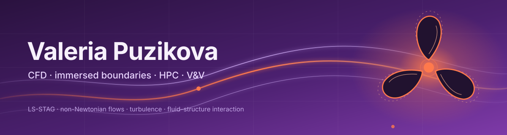

### CFD researcher and software developer with 15+ years of experience

Currently, I lead a team developing high-performance libraries for computation and data processing. Previously, I worked on physics engines at Huawei Moscow Research Center, on immersed-boundary methods at the Ivannikov Institute for System Programming RAS, and in industry at Fortum and other companies. I hold a PhD in Physics and Mathematics from Bauman Moscow State Technical University, where I also taught optimization methods and core undergraduate mathematics. I have authored 50+ papers, a textbook on non-Newtonian fluids, and 14 registered software programs.

---

### Research interests

- Immersed-boundary and cut-cell methods for viscous incompressible flows
- Non-Newtonian, viscoelastic and generalized Newtonian fluids
- Turbulence modelling: RANS, LES and DES
- Coupled fluid–structure interaction and aero/hydroelasticity
- Linear solvers: Krylov methods, multigrid and smoothers
- Domain decomposition, parallel algorithms and GPU computing
- Verification & validation of CFD codes
- Physics engines, AR/VR and RISC-V performance optimization
- Optimization methods

### Featured projects

<table>
<tr>
<td width="33%" valign="top">
<a href="https://github.com/vvp-cfd/LS-STAG-3D_parallel">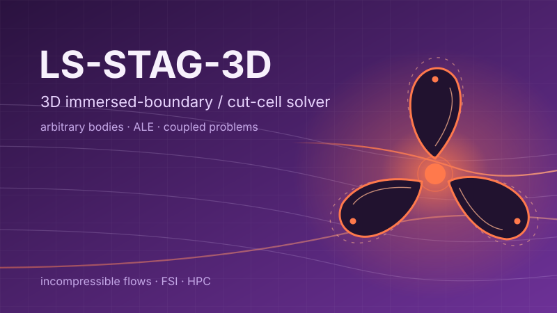</a>
 
<strong>LS-STAG-3D</strong> — 3D immersed-boundary solver for incompressible flows with arbitrary moving bodies and coupled FSI problems. Code: <code>LS-STAG-3D_parallel</code>.
</td>
<td width="33%" valign="top">
<a href="https://github.com/vvp-cfd/cfd-vv-suite">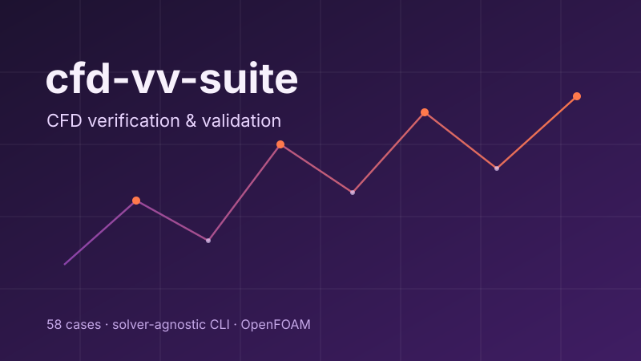</a>
 
<strong>cfd-vv-suite</strong> — open test suite for CFD verification and validation: 58 cases, solver-agnostic CLI, OpenFOAM integration.
</td>
<td width="33%" valign="top">
<a href="https://github.com/vvp-cfd/beamer-template-kit">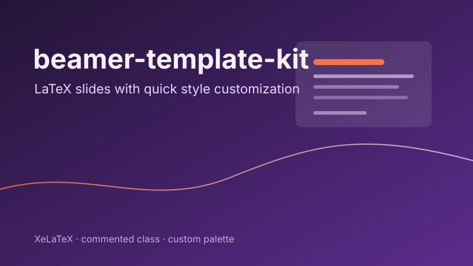</a>
 
<strong>beamer-template-kit</strong> — commented LaTeX Beamer class with quick style customization.
</td>
</tr>
</table>

### Featured publications

<table>
<tr>
<td width="33%" valign="top">
<a href="https://lanbook.ru/catalog/matematika/nenyutonovskie-zhidkosti-ot-matematicheskikh-modeley-do-postroeniya-chislennykh-metodov-i-programmnoy-realizatsii/">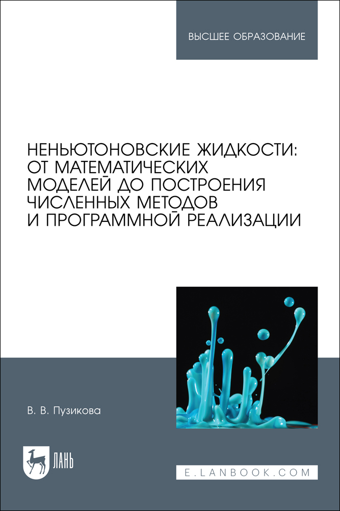</a>
 
<strong>Non-Newtonian Fluids: From Mathematical Models to the Construction of Numerical Methods and Software Implementation</strong> 
Lan, 2026. 132 p. (in Russian). 
<a href="https://lanbook.ru/catalog/matematika/nenyutonovskie-zhidkosti-ot-matematicheskikh-modeley-do-postroeniya-chislennykh-metodov-i-programmnoy-realizatsii/">Publisher page →</a>
</td>
<td width="33%" valign="top">
<a href="https://doi.org/10.1063/5.0277899">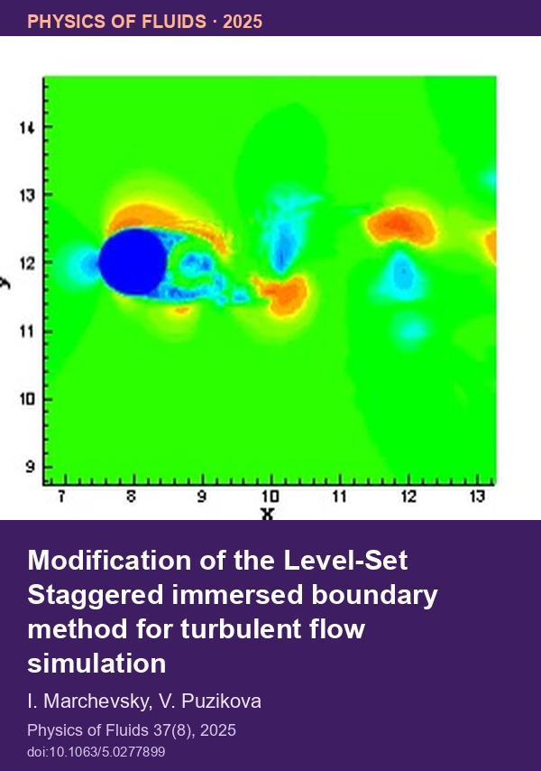</a>
 
<strong>Modification of the Level-Set Staggered immersed boundary method for turbulent flow simulation</strong> 
Physics of Fluids, 2025, vol. 37, issue 8, pp. 85–118. 
<a href="https://doi.org/10.1063/5.0277899">Paper DOI →</a>
</td>
<td width="33%" valign="top">
<a href="https://www.elibrary.ru/item.asp?id=28810902">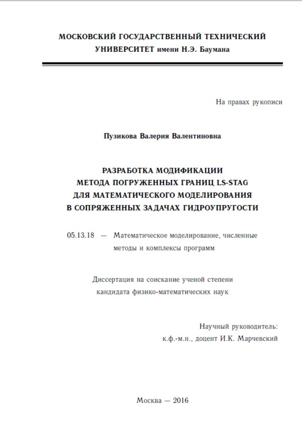</a>
 
<strong>Development of a Modification of the LS-STAG Immersed Boundary Method for Mathematical Modeling in Coupled Hydroelastic Problems</strong> 
PhD thesis, BMSTU, 2016. 150 p. (in Russian). 
<a href="https://www.elibrary.ru/item.asp?id=28810902">eLibrary →</a>
</td>
</tr>
</table>

### Featured SciVis

<table>
<tr>
<td width="33%" valign="top">
<a href="https://vvp-cfd.github.io/scivis/">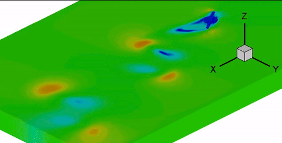</a>
 
<strong>Autorotating propeller</strong> — 3D case, velocity field.
</td>
<td width="33%" valign="top">
<a href="https://vvp-cfd.github.io/scivis/">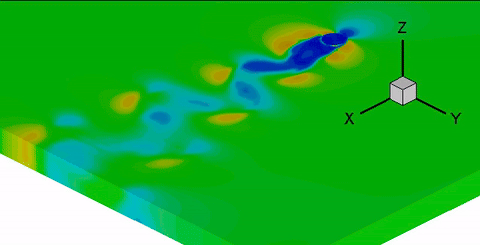</a>
 
<strong>Rotationally oscillating body</strong> — 3D case, velocity field.
</td>
<td width="33%" valign="top">
<a href="https://vvp-cfd.github.io/scivis/">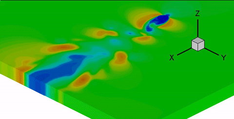</a>
 
<strong>Vertical oscillation, amplitude 1.1</strong> — 3D case, velocity field.
</td>
</tr>
</table>

Animated previews; full clips are on [SciVis](https://vvp-cfd.github.io/scivis/).

### Featured Conferences

<table>
<tr>
<td width="33%" valign="top">
<a href="https://2025.iccesconf.org/">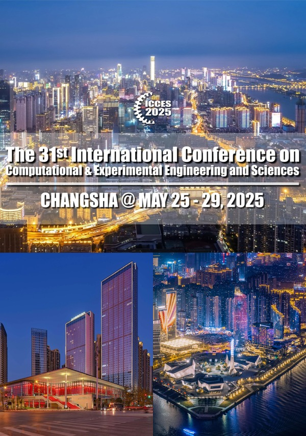</a>
 
<strong>ICCES2025</strong> 
Changsha, China · May 25–29, 2025 
<a href="https://2025.iccesconf.org/">Conference</a> ·
<a href="https://doi.org/10.1007/978-3-032-17313-3_80">Paper DOI</a>
</td>
<td width="33%" valign="top">
<a href="https://congress.cimne.com/coupled2017/">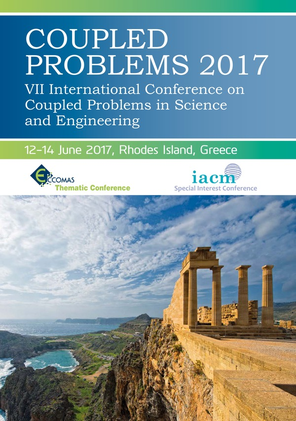</a>
 
<strong>COUPLED PROBLEMS 2017</strong> 
Rhodes, Greece · June 12–14, 2017 
<a href="https://congress.cimne.com/coupled2017/">Conference</a> ·
<a href="https://upcommons.upc.edu/bitstreams/02631476-838d-4ca0-a8c7-fb167f6ece3a/download">Paper</a>
</td>
<td width="33%" valign="top">
<a href="https://congress.cimne.com/coupled2015/">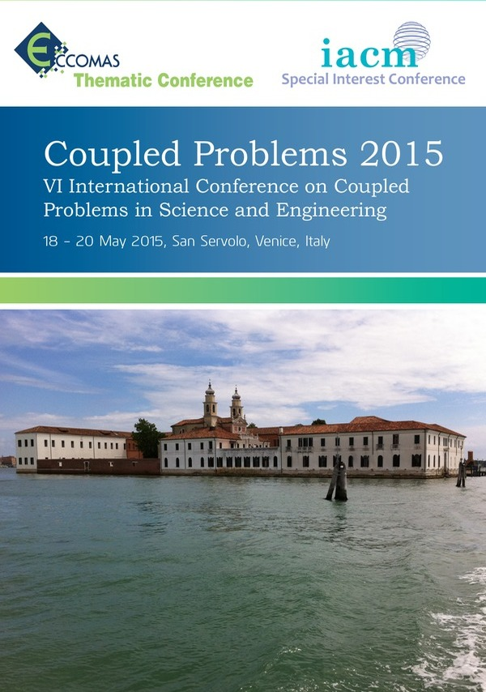</a>
 
<strong>COUPLED PROBLEMS 2015</strong> 
Venice, Italy · May 18–20, 2015 
<a href="https://congress.cimne.com/coupled2015/">Conference</a> ·
<a href="https://upcommons.upc.edu/bitstreams/add7aa83-e094-4962-8ad3-fe5a0742d3af/download">Paper 1</a> ·
<a href="https://upcommons.upc.edu/bitstreams/e483f7df-1ebc-46f1-a7b0-f172f6ddf0b0/download">Paper 2</a>
</td>
</tr>
</table>

### Now

Leading high-performance libraries for computation and data processing · developing **LS-STAG-3D** · maintaining **cfd-vv-suite** · writing [Telegram notes](https://t.me/turbulence7D) on CFD, RISC-V, AI news and my work.

---

[Website](https://vvp-cfd.github.io/) · [Publications](https://vvp-cfd.github.io/publications/) · [SciVis](https://vvp-cfd.github.io/scivis/) · [Software](https://vvp-cfd.github.io/software/) · [Conferences](https://vvp-cfd.github.io/conferences/)
